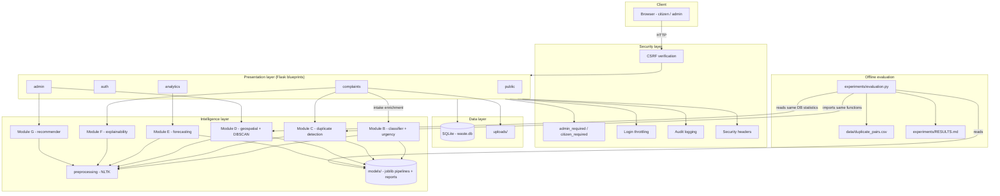

# 09 · System Architecture

## 9.1 Architectural Style

SmartWaste 2.0 uses a **layered monolith** with strict internal boundaries:
Flask blueprints own HTTP concerns, `intelligence/` owns all ML/geospatial
computation, `db.py` owns persistence, and `security.py` owns cross-cutting
protection (CSRF, access control, throttling, audit). The intelligence layer
is importable both from web routes and from offline experiment scripts, which
is what allows the evaluation harness to measure the *production* scoring
code.

## 9.2 Architecture Diagram

## 9.3 Request Lifecycle (complaint submission)

1. Browser `POST /report` with CSRF token.
2. `security._verify_csrf` validates the token (400 otherwise).
3. `complaints.services.create_complaint` validates input, saves the image.
4. **Module B** predicts category + urgency; **Module C** scans recent
   complaints for possible duplicates; **Module F** builds the explanation.
5. Row + history event + prediction are inserted in one transaction; a
   tracking ID is assigned.
6. Best-effort threads: administrator e-mail (Module A) — failures logged,
   never raised.
7. Success page shows the tracking ID, AI output and duplicate hints.

## 9.4 Design Decisions

* **Enrich at write time** — classification happens before insert so every
  downstream view (queue, map, forecast) is immediately consistent.
* **Never auto-reject** — duplicates are *surfaced*; humans decide.
* **Persist snapshots** — clusters and model reports are stored artefacts,
  so dashboards do not recompute expensive state per request.
* **Honest degradation** — every module can report "insufficient data"
  instead of a misleading number.
