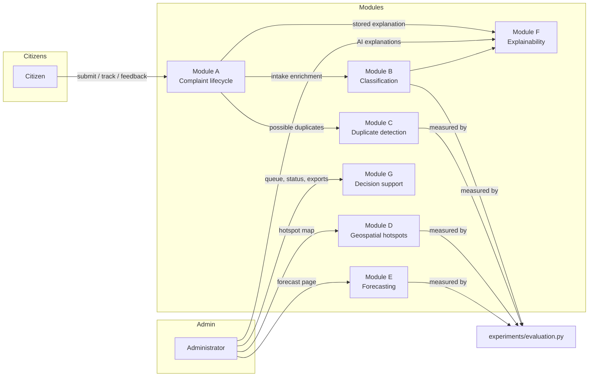

# 10 · Module Description

The system is organised into seven modules (A–G) plus shared infrastructure.

## Module A — Complaint Lifecycle (`modules/authentication`, `modules/complaints`)
Citizen signup/login/profile, complaint submission with validation, image
storage, tracking-ID assignment, status timeline with history events,
in-app notifications, feedback (rating + comment), duplicate-check API and
best-effort e-mails (new report to the municipality, status change to the
citizen).

## Module B — Classification (`intelligence/complaint_classifier.py`,
`intelligence/priority_predictor.py`, `intelligence/model_training.py`)
Eight-class waste categorisation and four-level urgency prediction over
TF-IDF features. Candidate models (Logistic Regression, Random Forest) are
compared by 5-fold CV; the winner and its metrics are written to
`models/category_report.json` / `models/urgency_report.json`. Predictions
below `ML_CONFIDENCE_THRESHOLD` are flagged `needs_review`.

## Module C — Duplicate Detection (`intelligence/duplicate_detection.py`)
Fuses TF-IDF cosine similarity, haversine distance (2 km gate, neutral 0.4
when unknown) and category agreement into a weighted score
(0.65/0.25/0.10). Thresholds: text gate 0.45, combined 0.55. The shared
helpers `pair_similarity()` and `score_duplicate()` are used by both the live
path and the offline evaluation.

## Module D — Geospatial Hotspots (`intelligence/geospatial_analysis.py`,
`intelligence/hotspot_detection.py`)
Coordinate parsing/validation, area inference from location text, haversine
utilities, DBSCAN clustering (default eps 400 m, min-samples 3, haversine
metric), persisted cluster snapshots with parameters and a silhouette quality
score, recurring-hotspot statistics and the admin map API.

## Module E — Forecasting (`intelligence/forecasting.py`)
Builds daily complaint-count series from history (180-day window), applies a
chronological split, evaluates seasonal-naive (t−7), 7-day moving average and
a Random Forest regressor (lags 1–28 + calendar features), and reports
MAE/RMSE plus a ±1.96 × test-RMSE uncertainty band. States
`insufficient`/`baseline_only` when history is too short.

## Module F — Explainability (`intelligence/explainability.py`)
Produces a JSON explanation per prediction: model identity, top per-class
text features with contributions, and context factors (citizen's own
category/priority). Stored with the prediction and rendered on the admin and
citizen detail pages.

## Module G — Decision Support (`intelligence/recommender.py`,
`modules/admin/services.py`, `modules/admin/routes.py`)
Filterable admin queue, KPI/chart series, backlog-age and rising-area
recommendations, overdue detection, CSV/PDF exports, user management and the
audit-log views.

## Shared Infrastructure
`config.py` (all tunables), `db.py` (schema + migrations), `security.py`
(CSRF, ACL, throttling, audit), `app.py` (application factory, template
helpers, error handlers, security headers), `static/` + `templates/`
(responsive UI, Chart.js dashboards).
