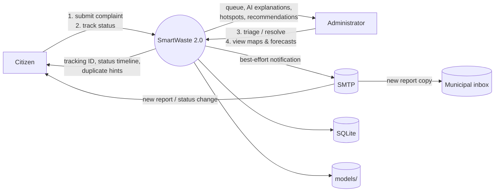
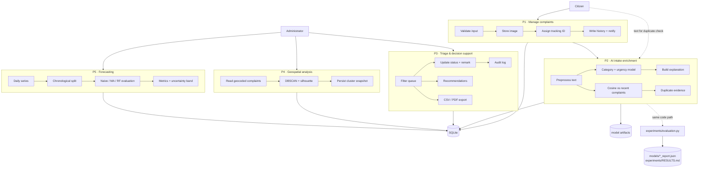

# 11 · Data-Flow Diagrams

## 11.1 Level 0 — Context Diagram

## 11.2 Level 1 — Core Processes

## 11.3 Data-Flow Narrative

1. **Submit flow (P1 → P2 → storage):** validated form data passes through
   preprocessing, model inference and duplicate scanning; the complaint row,
   its history event, its prediction (with explanation) and any duplicate
   evidence are written together, then notifications are dispatched
   best-effort.
2. **Triage flow (P3):** the administrator filters the stored rows, updates
   status with a remark (audited), and exports CSV/PDF from the same store.
3. **Analysis flows (P4, P5):** read-only over stored complaints; both
   persist their outputs (cluster snapshot; forecast payload) for dashboards.
4. **Evaluation flow:** the offline harness reuses the Module C scoring
   functions and the Module D/E logic against labelled corpora, emitting the
   JSON/Markdown reports quoted in this documentation.
