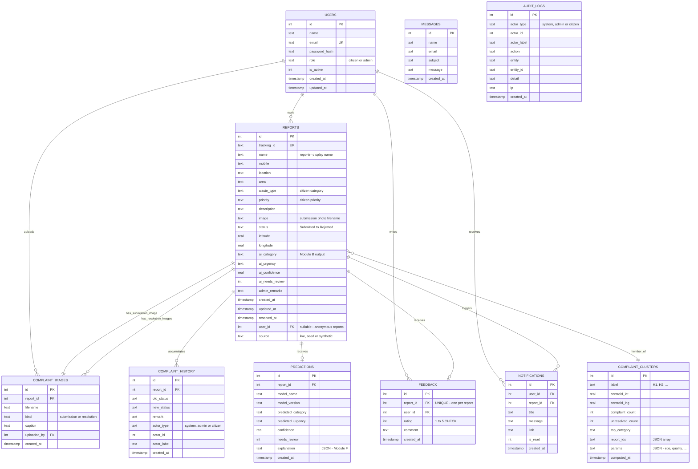

# 12 · Entity-Relationship Diagram

## 12.1 Relationship Notes

* **USERS → REPORTS** is *optional* (`ON DELETE SET NULL`): anonymous
  complaints are allowed and remain viewable through their tracking link.
* **REPORTS → PREDICTIONS** is 0..1 in practice (latest prediction is
  read with `ORDER BY id DESC LIMIT 1`); history keeps older rows.
* **REPORTS → FEEDBACK** is one-to-one (`UNIQUE(report_id)`), enforced by
  the schema.
* **COMPLAINT_CLUSTERS** is a *snapshot table*, not a normal parent of
  reports: `report_ids` is a JSON array of member IDs from the most recent
  run (the whole table is replaced on re-clustering).
* **AUDIT_LOGS** and **MESSAGES** are standalone (weak) entities; audit rows
  reference entities textually (`entity`, `entity_id`) so they survive
  deletion of the referenced row.
