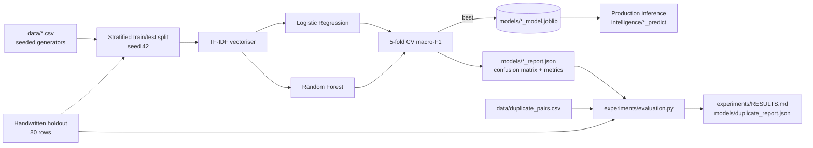

# 15 · Machine-Learning Pipeline

## 15.1 End-to-End Pipeline

## 15.2 Datasets

| Dataset | Rows | Source | File |
|---|---|---|---|
| Category / urgency training | 800 | seeded synthetic generator | `data/seeded_training.csv` |
| Handwritten holdout | 80 | independently written phrases | `data/holdout.csv` |
| Duplicate pairs | 500 (250/250) | constructed pairs, `construction` column | `data/duplicate_pairs.csv` |
| Live database | 0 at build time | real submissions | `waste.db` |

All corpora are synthetic; `data/README.md` and `data/ANNOTATION.md` state
this explicitly and describe the real-data annotation workflow to replace them.

## 15.3 Model Selection & Reproducibility

* Single random seed (42) for splits, vectoriser and estimators.
* `models/training_meta.json` records the **SHA-256 of the training data**
  and the training timestamp, so a stale model is detectable.
* Evaluation reads the same JSON reports the training script wrote — no
  metric is hand-entered anywhere in this repository.
* Model retraining is a manual action (`python scripts/train_models.py`);
  the admin `/admin/models` page shows the current metrics and a retrain
  button guarded by a per-process throttle.

## 15.4 Honest Reporting Rules

1. CV metrics, holdout-test metrics and independent-handwritten metrics are
   reported **separately** (the handwritten holdout is the most honest
   number and is notably lower: category F1 0.7907, urgency F1 0.856).
2. When the database lacks data (no coordinates, no history), the evaluation
   prints *insufficient* rather than a metric — see sections D and E of
   `experiments/RESULTS.md`.
3. Every results table carries the synthetic-data caveat.
