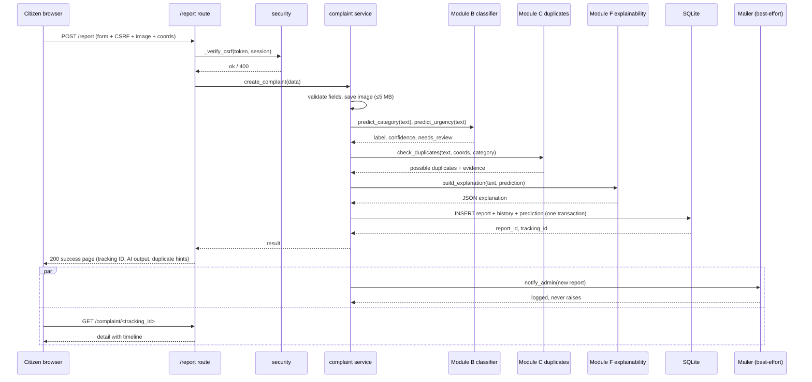

# 17 · Implementation

## 17.1 Repository Layout

```
SmartWaste/
├── app.py                 # application factory, helpers, error handlers, security headers
├── config.py              # every tunable constant (thresholds, vocabularies, weights)
├── db.py                  # schema, migrations, connection helpers
├── security.py            # CSRF, access control, throttling, audit logging
├── modules/
│   ├── authentication/    # Module A - accounts
│   ├── complaints/        # Module A - lifecycle, PDF, e-mail
│   ├── admin/             # Module G - console, exports, users, audit views
│   ├── public/            # landing, contact, privacy
│   └── analytics/         # chart/forecast endpoints
├── intelligence/          # Modules B-G (importable offline too)
│   ├── preprocessing.py  ├── complaint_classifier.py
│   ├── priority_predictor.py ├── model_training.py
│   ├── duplicate_detection.py ├── geospatial_analysis.py
│   ├── hotspot_detection.py   ├── forecasting.py
│   ├── explainability.py      └── recommender.py
├── models/                # joblib pipelines + *_report.json + training_meta.json
├── experiments/           # evaluation.py, RESULTS.md
├── data/                  # seeded corpora, duplicate pairs, README, ANNOTATION
├── scripts/               # generate_dataset.py, build_duplicate_pairs.py, train_models.py
├── tests/                 # 73 tests in 6 files
├── templates/ static/     # UI (citizen + admin bases)
├── docs/                  # this documentation set
├── .github/workflows/ci.yml
├── requirements.txt requirements-dev.txt Procfile render.yaml
```

## 17.2 Complaint Submission Sequence



## 17.3 Key Implementation Decisions

* **Blueprint per concern** keeps route files small and testable; each test
  file imports `create_app()`.
* **`config.py` as the single source of truth** for thresholds
  (`DUPLICATE_TEXT_THRESHOLD`, `HOTSPOT_EPS_METRES`, `ML_CONFIDENCE_THRESHOLD`,
  …) so UI, ML and tests can never drift apart.
* **AI enrichment happens before the INSERT** (`services.create_complaint`),
  guaranteeing every stored row carries its prediction and explanation.
* **Background threads for e-mail** (`status_service` → `send_status_email`)
  keep response latency unaffected; failures are caught and logged.
* **Template filters** (`format_datetime`, `time_ago`, `status_badge`,
  `ai_badge`) centralise formatting; `zip` remains a standard filter.
* **Chart safety:** every dashboard calls `chartsAvailable()` before touching
  Chart.js, so a CDN outage degrades to numbers, not JS errors.

## 17.4 PDF Export

`modules/complaints/pdf_service.py` builds the document with reportlab:

* `build_complaint_pdf(report, history, prediction, recommended_action,
  audience)` — audience `admin` shows full mobile/coords; `citizen` masks
  them (`+91-98XXXXXX76`).
* Titles/locations pass through `_safe()` (CP1252-safe) to avoid Unicode
  crashes; page compression disabled for maximum compatibility.
* Routes: `GET /admin/complaint/<id>/pdf` (audited) and
  `GET /complaint/<id>/pdf` (same access rules as the detail page).

## 17.5 Status-Change E-mails

`update_status()` in `modules/complaints/services.py` records the history +
audit row inside the transaction, then — only when the status actually
changed and the complaint has an owning user with an e-mail — starts a
background thread that renders the escaped HTML message and hands it to
`email_service._deliver()`. `_smtp_ready()` decides silently whether SMTP is
configured; unconfigured deployments simply skip e-mail.
