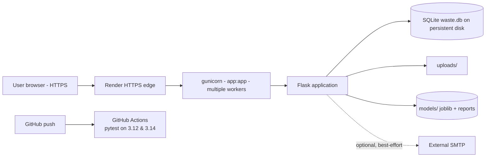

# 22 · Deployment

## 22.1 Deployment Topology

## 22.2 Environments

| Env | Command | Notes |
|---|---|---|
| Local dev | `python app.py` or `flask run` | `DEBUG` from `.env`, local `waste.db` |
| Production | `gunicorn app:app` (Procfile) | `SECRET_KEY`, `ADMIN_*`, `SMTP_*`, `REPORT_NOTIFY_EMAIL` from env |
| CI | GitHub Actions | throw-away `.env`, temp DB, no secrets |

## 22.3 Render Blueprint (`render.yaml`)

* **Runtime:** python, **build:** `pip install -r requirements.txt`
* **Start:** `gunicorn app:app`
* **Disk:** attached volume mounted at the project root so `waste.db` and
  `uploads/` survive redeploys (SQLite requires a persistent filesystem)
* **Environment:** `SECRET_KEY`, `ADMIN_USERNAME`, `ADMIN_PASSWORD`,
  `REPORT_NOTIFY_EMAIL`, `SMTP_HOST`, `SMTP_PORT`, `SMTP_USER`,
  `SMTP_PASSWORD`, `SMTP_FROM`, `WEB_CONCURRENCY`
* Live instance: https://smartwaste-nyvw.onrender.com/

## 22.4 First-Run Checklist

1. Set `.env` (or platform env): `SECRET_KEY` (≥ 32 random bytes),
   `ADMIN_USERNAME`/`ADMIN_PASSWORD`, optional SMTP + `REPORT_NOTIFY_EMAIL`.
2. Start the app — `init_db()` creates all tables on first request.
3. Run `python scripts/train_models.py` if `models/` artefacts are absent.
4. Run `python -m pytest tests/ -q` (expects 73 passed).
5. Log in as the admin, open `/admin/models` and confirm the evaluation
   reports render.

## 22.5 Operational Notes

* **Backups:** copy `waste.db` (and `uploads/`) — SQLite is a single file.
* **Upgrades:** schema migrations are additive and run at startup; no manual
  DDL.
* **Scaling:** gunicorn workers via `WEB_CONCURRENCY`; move to PostgreSQL by
  replacing `db.py` connections (SQL is standard and parameterised).
* **Observability:** application logs to stdout (captured by the host);
  failed e-mails and clustering errors are logged, never raised to users.
