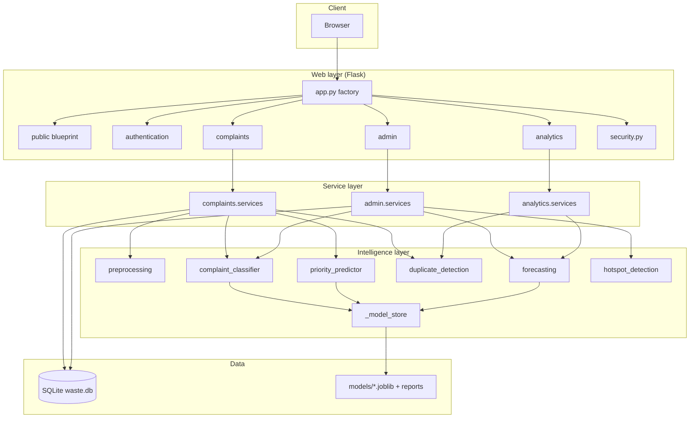
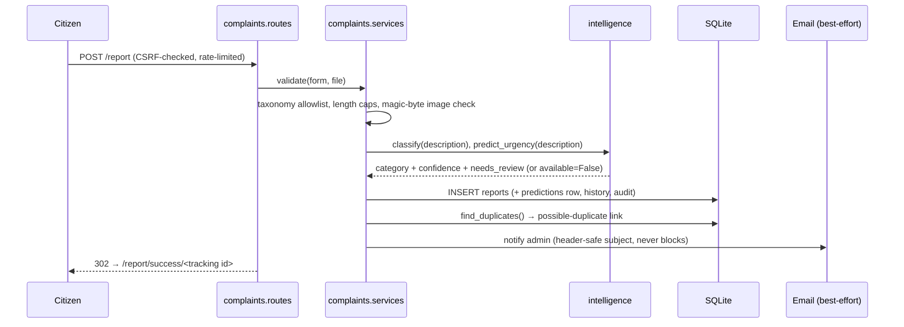

# SmartWaste 2.0 — Project Architecture

This document describes the architecture **as implemented** in this
repository. It complements `docs/09-system-architecture.md` (report-style
diagrams) with an engineer-facing map of layers, modules and data flow.

## 1. Layered view

```text
┌────────────────────────────────────────────────────────────────────┐
│  Presentation   templates/*.html  +  static/app.js, styles.css    │
│                (server-rendered Jinja, progressive enhancement)    │
├────────────────────────────────────────────────────────────────────┤
│  Web layer      app.py (factory, before/after hooks)              │
│                 modules/{public,authentication,complaints,        │
│                         admin,analytics}  — Flask blueprints      │
│                 security.py (CSRF, role gates, rate limits,       │
│                              headers, session hardening)          │
├────────────────────────────────────────────────────────────────────┤
│  Service layer  modules/*/services.py (validation, workflows,     │
│                 audit writes, notifications, exports)             │
├────────────────────────────────────────────────────────────────────┤
│  Intelligence   intelligence/*  — pure Python, no Flask imports   │
│                 preprocessing, complaint_classifier,              │
│                 priority_predictor, duplicate_detection,          │
│                 forecasting, hotspot_detection, explainability,   │
│                 model_training, model_evaluation, _model_store    │
├────────────────────────────────────────────────────────────────────┤
│  Data           db.py (SQLite schema v5, migrations, helpers)     │
│                 models/*_model.joblib + *_report.json (artifacts) │
│                 data/* (synthetic corpora, documented)            │
└────────────────────────────────────────────────────────────────────┘
```

Rules that keep the layers honest:

- **`intelligence/` never imports Flask** — every model, cluster and
  forecast is unit-testable in isolation (see `tests/test_ml_units.py`,
  `tests/test_evaluation.py`).
- **Routes stay thin** — parsing, authorisation and flash/redirect live in
  the route; validation, persistence and side effects live in
  `modules/*/services.py`.
- **All state changes write an audit row** (`audit_logs`) through
  `security.audit()`.

## 2. Component map



## 3. Blueprints and responsibilities

| Blueprint | Prefix | Responsibility | Key routes |
|---|---|---|---|
| `public` | `/` | Marketing/help pages, contact inbox | `/`, `/contact`, `/about`, `/team`, `/founder` |
| `authentication` | `/` | Signup, login/logout, per-account lockout | `/signup`, `/login`, `/logout` |
| `complaints` | `/` | Citizen submission, tracking, detail, feedback, PDF, duplicate check | `/report`, `/track`, `/complaint/<id>`, `/complaint/<id>/feedback`, `/report/duplicate-check` |
| `admin` | `/admin` | Operations console: dashboard, queue, AI review, duplicate links, users, audit, models, exports | `/admin`, `/admin/complaints`, `/admin/complaint/<id>/ai-review` |
| `analytics` | *(none)* | JSON API for the admin dashboard: filters → charts, KPIs, recommendations, feedback/duplicate/forecast payloads | `/admin/api/overview` (admin-gated) |

All blueprints are registered **without** a `url_prefix` (`modules/__init__.py`);
route paths carry their own prefixes (e.g. `/admin/...`, `/report`).

Registration order is fixed in `modules/__init__.py::ALL_BLUEPRINTS`.

## 4. Report submission — end-to-end lifecycle



Design points:

- **AI output is advisory.** `reports.ai_category`/`ai_urgency` store the
  model's suggestion; the citizen's `waste_type`/`priority` are stored
  separately, and an administrator's `final_*` values (with
  `ai_reviewed_by/at/note`) overwrite neither the original prediction row
  nor the citizen's input.
- **Model versioning travels with every prediction**: the `predictions` row
  stores `model_name` + `model_version` (the training timestamp), and every
  administrator review copies that version into `prediction_feedback`.
- **Duplicate detection** runs on submission and on demand
  (`/report/duplicate-check`, debounced client-side), combining TF-IDF
  cosine similarity, haversine distance, recency window and category
  agreement; linking is an explicit admin action stored in
  `reports.duplicate_of_report_id`.

## 5. Intelligence layer internals

| Module | Algorithm | Artifact |
|---|---|---|
| `preprocessing.py` | NFKD fold, URL/email/HTML strip, NLTK tokenize + lemmatise + stop-words, regex fallback when NLTK data is absent | none (deterministic) |
| `complaint_classifier.py` | TF-IDF + best-of-{Logistic Regression, Random Forest} by 5-fold CV F1-macro | `category_model.joblib`, `category_report.json` |
| `priority_predictor.py` | same recipe for urgency; LR selected | `urgency_model.joblib`, `urgency_report.json` |
| `duplicate_detection.py` | TF-IDF cosine + haversine + recency + category gate (text gate then combined gate) | none (cached candidate matrix in-process) |
| `forecasting.py` | lag/rolling/DOW features → RandomForestRegressor; seasonal-naive and moving-average baselines; chronological split; refuses `insufficient`/`baseline_only` when history is short | in-process (memoised) |
| `hotspot_detection.py` | DBSCAN over geocoded complaints, explicit eps/min_samples | `complaint_clusters` table |
| `explainability.py` | plain-language "why this priority" composition from citizen + model inputs | none |
| `model_training.py` / `model_evaluation.py` | reproducible training (seed 42) and evaluation entry points | reports under `models/` |

Model selection rule (documented and tested): **highest mean CV F1-macro on
the training partition; ties prefer Logistic Regression.** Holdout sets are
kept untouched until final evaluation; metrics live in
`docs/ML_EVALUATION.md`.

## 6. Security architecture (cross-cutting)

```text
request
  │
  ├─ security.install_security() hooks
  │    ├─ CSRF: double-submit token on every state-changing form AND JSON POST
  │    ├─ session cookie: HttpOnly, SameSite=Lax, Secure in production
  │    ├─ role gates: admin_required / citizen_required decorators
  │    ├─ rate limits: login throttle (per identifier, truncated keys),
  │    │              public throttle on /report, /report/duplicate-check,
  │    │              /signup, /contact (PUBLIC_RATE_MAX / PUBLIC_RATE_WINDOW)
  │    ├─ response headers: CSP, Permissions-Policy, prod HSTS,
  │    │                    Cache-Control: no-store on non-static HTML/PDF
  │    └─ audit(): append-only audit_logs for auth, submissions,
  │                status changes, AI reviews, duplicate links, exports
  ├─ route: parse + authorise
  └─ service: validate (allowlists, caps, magic bytes) → persist
```

## 7. Data ownership

- **SQLite (`db.py`)** is the single source of truth at runtime; schema
  version is tracked with `PRAGMA user_version = 5` (`SCHEMA_VERSION`).
- **`models/`** holds committed training artifacts + JSON reports; the app
  loads them through `_model_store` and can retrain from the admin models
  page (`scripts/train_models.py` is the CLI path).
- **`data/`** holds the synthetic corpora used for training/evaluation —
  every file carries its synthetic provenance (see `data/README.md`).
- **`experiments/RESULTS.md`** is the source of truth for quoted metrics.

## 8. Deployment topology

```text
git push → Render (render.yaml)
             ├─ build: pip install -r requirements.txt
             ├─ start: gunicorn app:app  (Procfile)
             └─ env: SECRET_KEY, ADMIN_*, REPORT_NOTIFY_EMAIL (sync:false),
                     DATABASE_PATH on persistent disk
optional: python app.py locally  →  http://127.0.0.1:5000
```

Static files are served by Flask in development; in production the same
blueprints run behind gunicorn with `Cache-Control` only applied to
non-static responses (static assets keep long-lived caching).

## 9. Key design decisions

| Decision | Rationale | Trade-off accepted |
|---|---|---|
| Server-rendered Jinja + vanilla JS | zero front-end build, easy to audit, works without JS for core flows | less interactive than an SPA |
| Classical ML (TF-IDF + LR/RF) over deep learning | small synthetic corpus, fully explainable, reproducible on CPU, honest metrics | lower ceiling on very noisy text |
| SQLite | zero-ops, portable, adequate for demo load | single-writer; would need Postgres for multi-instance scale |
| AI suggestions never auto-apply | administrators confirm/correct; original prediction immutable for evaluation honesty | one extra click per complaint |
| Synthetic data, disclosed everywhere | no privacy/consent risk; metrics validate the pipeline only | no real-world accuracy claim (explicitly pending) |
| Append-only `prediction_feedback` | correction rates per model version later, nothing overwritten | reviews before the table existed counted separately (`legacy_reviews`) |
